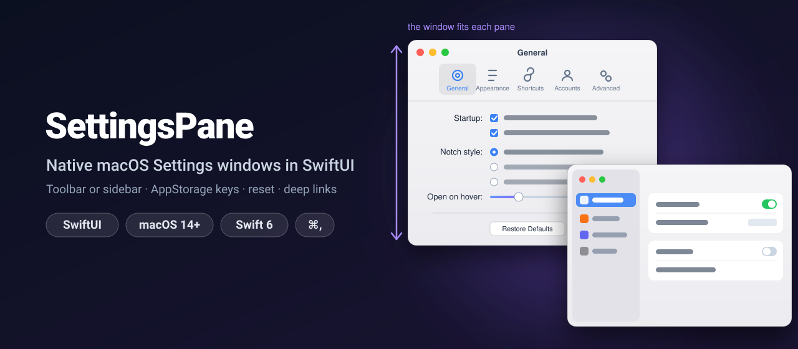
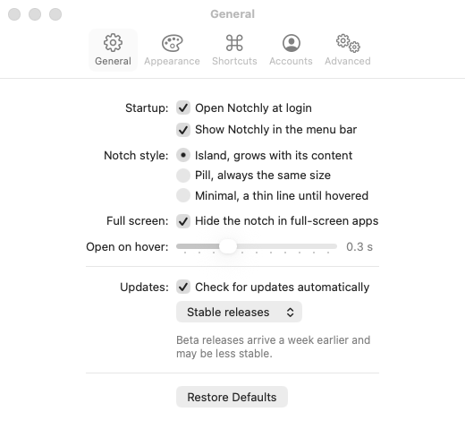
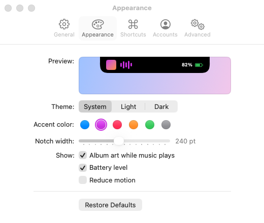
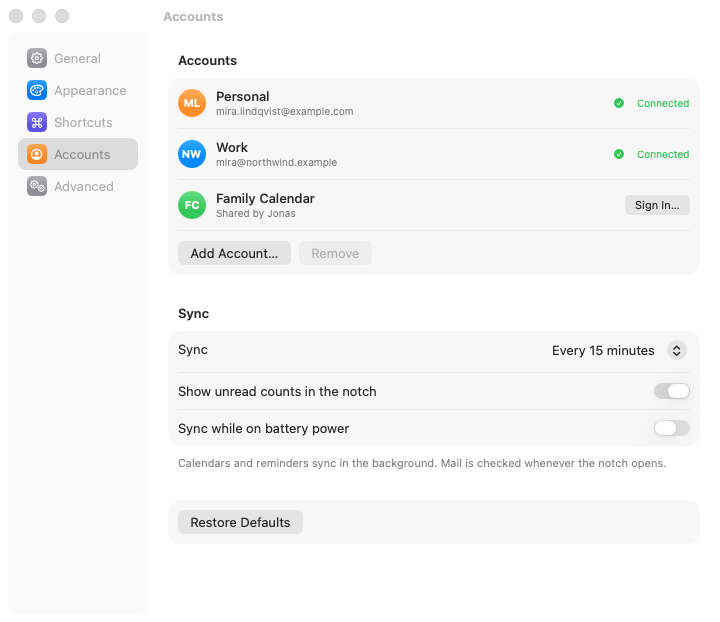
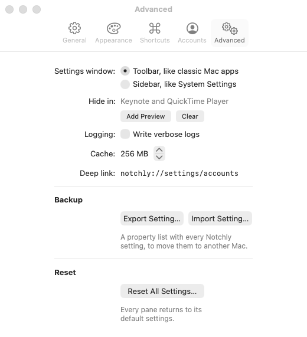

<p align="center">
  
</p>

<p align="center">
  <a href="https://github.com/halilozel1903/SettingsPane/actions/workflows/ci.yml"></a>
  
  
  
  <a href="LICENSE"></a>
</p>

**SettingsPane** builds the Settings window of a Mac app from a list of panes. Pick the **toolbar style** of classic Mac apps, where the window takes the height of each pane, or the **sidebar style** of System Settings. Rows line up with **right-aligned labels** like a native form, settings are typed **`SettingsKey`s** that work with `@AppStorage`, every pane gets **Restore Defaults**, the whole app can **export and import** its settings as a property list, and `openSettings(pane:)` or a **URL** opens the window on any pane. ⌘, comes from SwiftUI's `Settings` scene.

```swift
Settings {
    SettingsPaneView {
        Pane("General", systemImage: "gearshape") { GeneralPane() }
        Pane("Appearance", systemImage: "paintpalette") { AppearancePane() }
        Pane("Accounts", systemImage: "person.crop.circle") { AccountsPane() }
        Pane("Advanced", systemImage: "gearshape.2") { AdvancedPane() }
    }
}
```

## Screenshots

Captured by CI from *Notchly*, the made-up notch utility in the example project, on macOS 26.

| Toolbar style: General | Toolbar style: Appearance |
| :---: | :---: |
|  |  |

| Sidebar style: Accounts | Toolbar style: Advanced |
| :---: | :---: |
|  |  |

## Features

- **A pane builder**: `SettingsPaneView { Pane("General", systemImage: "gearshape") { … } }`, with `if`, `for` and `if #available` in the list. Each pane's identifier comes from its title (`"Advanced Options"` → `advanced-options`) or from `id:`.
- **Toolbar style**: a `TabView` in the `Settings` scene, which macOS turns into the settings toolbar. Every pane has the same width and its own height, and the window resizes to it with an animation when you switch panes, like Safari, Mail and most Mac apps.
- **Sidebar style**: System Settings since macOS 13. A sidebar of panes with SF Symbols on colored tiles, a fixed-size window and grouped forms.
- **Classic form layout**: `SettingsForm`, `SettingsRow` and `SettingsSection` give the toolbar style a grid with right-aligned labels ending in a colon and the controls in a column next to them. The same declaration becomes a grouped `Form` with `LabeledContent` rows and `Section`s in the sidebar style.
- **Typed settings**: `SettingsKey("theme", default: Theme.system, pane: "appearance")` holds the defaults key, the default value and the owning pane. Use it with `@AppStorage(key)` or with `@SettingsDefault(key)`, which also stores arrays and dictionaries and updates when the value changes anywhere.
- **A registry of keys**: `SettingsKeys` registers the defaults at launch, restores the defaults of one pane or of every pane, tells whether a pane has changed, and exports or imports the settings as a property list, with values converted to each key's type and unknown keys skipped.
- **Reset UI**: `SettingsResetButton` asks for confirmation, then resets a pane ("Restore Defaults") or everything ("Reset All Settings…"). Every `@AppStorage` showing those settings updates at once.
- **Deep links**: `openSettings(pane: .accounts)` opens the Settings window on a pane, or switches the open window to it. `SettingsPaneLink` is the button for it, and `SettingsURLScheme` with `.opensSettings(for:)` handles links such as `notchly://settings/accounts`.
- **Remembers the last pane**: the window opens on the pane the user saw last, stored in the defaults. Turn it off or change the key with `persistence:`.
- **⌘,** and the app menu's **Settings…** item come from SwiftUI's `Settings` scene, so they behave like every other Mac app.
- **Testable logic**: pane selection, last-pane persistence, the key registry, reset, export and import are plain values over a `SettingsStore` protocol, tested with Swift Testing against `UserDefaults` and `InMemorySettingsStore`.
- **Swift 6 strict concurrency**, no dependencies.

## Installation

In Xcode choose **File › Add Package Dependencies…** and enter:

```
https://github.com/halilozel1903/SettingsPane
```

Or add it to `Package.swift`:

```swift
dependencies: [
    .package(url: "https://github.com/halilozel1903/SettingsPane", from: "1.0.0")
]
```

## Usage

### Keys

Declare each setting once, with its default and its pane, and list them in a registry:

```swift
import SettingsPane

extension PaneID {
    static let general: PaneID = "general"
    static let appearance: PaneID = "appearance"
}

enum Theme: String, CaseIterable, SettingsValue {
    case system, light, dark
}

enum AppSettings {
    static let launchAtLogin = SettingsKey("launchAtLogin", default: true, pane: .general)
    static let hoverDelay = SettingsKey("hoverDelay", default: 0.3, pane: .general)
    static let theme = SettingsKey("theme", default: Theme.system, pane: .appearance)
    static let hiddenApps = SettingsKey("hiddenApps", default: ["Keynote"], pane: .appearance)

    static let registry = SettingsKeys(launchAtLogin, hoverDelay, theme, hiddenApps)
}

@main
struct NotchlyApp: App {
    init() {
        AppSettings.registry.register()      // UserDefaults.register(defaults:) for every key
    }
    …
}
```

`SettingsValue` covers `Bool`, `Int`, `Double`, `String`, `Data`, `Date`, arrays and string-keyed dictionaries of those, and enums backed by a `String` or an `Int`.

### The window

```swift
Settings {
    SettingsPaneView(style: .toolbar) {           // or .sidebar
        Pane("General", systemImage: "gearshape") {
            GeneralPane()
        }
        Pane("Appearance", systemImage: "paintpalette", tint: .blue) {   // tint: the sidebar tile
            AppearancePane()
        }
        if showsLabs {
            Pane("Labs", systemImage: "flask") { LabsPane() }
        }
    }
}
```

| Parameter | Default | |
| --- | --- | --- |
| `style` | `.toolbar` | `.toolbar` or `.sidebar` |
| `defaultPane` | the first pane | Shown when no last pane is remembered |
| `persistence` | `.standard` | Where the last pane is stored (`"SettingsPane.selectedPane"`), `nil` to not remember it |
| `layout` | `SettingsPaneLayout()` | Toolbar width 520, sidebar window 720 × 500, sidebar 200 |
| `router` | `SettingsRouter.shared` | What `openSettings(pane:)` talks to |

### A pane

```swift
struct GeneralPane: View {
    @AppStorage(AppSettings.launchAtLogin) private var launchAtLogin: Bool
    @SettingsDefault(AppSettings.hoverDelay) private var hoverDelay: Double

    var body: some View {
        SettingsForm {
            SettingsRow("Startup") {                       // "Startup:" in the toolbar style
                Toggle("Open Notchly at login", isOn: $launchAtLogin)
            }
            SettingsRow("Open on hover") {
                Slider(value: $hoverDelay, in: 0...1)
                    .frame(width: 180)
            }
            SettingsSection("Updates") {                   // a separator, then the rows
                SettingsRow { Toggle("Check automatically", isOn: $checksForUpdates) }
            } footer: {
                Text("Beta releases arrive a week earlier.")
            }
            SettingsSection {
                SettingsRow {
                    SettingsResetButton(pane: .general, keys: AppSettings.registry)
                }
            }
        }
    }
}
```

| | Toolbar style | Sidebar style |
| --- | --- | --- |
| `SettingsForm` | `Grid`, centered, with padding | `Form` with `.formStyle(.grouped)` |
| `SettingsRow("Theme")` | `Theme:` right-aligned, the controls stacked to its right | `LabeledContent("Theme")` |
| `SettingsRow { … }` | The controls in the control column | A plain form row |
| `SettingsSection("Sync")` | A separator, a title, the rows, a footer under the controls | `Section` with a header and a footer |

Hide the labels of pickers inside a row with `.labelsHidden()`; the row's label stands for them. Use `.settingsPaneStyle(.toolbar)` to preview a pane on its own.

### Reset, export and import

```swift
let registry = AppSettings.registry

registry.reset(pane: .appearance)          // Restore Defaults for one pane
registry.resetAll()                        // every setting
registry.isDefault(pane: .general)         // false once the user changed something

let data = try registry.exportPropertyList()               // XML plist, every key
let result = try registry.importPropertyList(data)         // applied, skipped, invalid
```

Every method takes `in:` (or `from:`/`into:`) to work on another `UserDefaults` suite or an `InMemorySettingsStore` in tests. In the UI, `SettingsResetButton(pane:keys:)` and `SettingsResetButton(keys:)` ask before resetting, and `SettingsArchivePanel.exportSettings(_:)` and `importSettings(_:)` show the save and open panels. Use `.settingsDefaults(suite)` to point the buttons, the last pane and `@AppStorage` at another suite.

### Open a pane

```swift
struct ContentView: View {
    @Environment(\.openSettings) private var openSettings

    var body: some View {
        Button("Manage Accounts…") {
            openSettings(pane: .accounts)        // opens Settings on Accounts, or switches to it
        }
        SettingsPaneLink("Appearance…", pane: .appearance)
        SettingsLink()                           // SwiftUI's own: the last pane
    }
}
```

### URL scheme

```swift
let links = SettingsURLScheme(scheme: "notchly")
links.url(for: .accounts)            // notchly://settings/accounts
links.pane(from: url)                // reads notchly://settings/accounts and notchly://settings?pane=accounts

WindowGroup {
    ContentView()
        .opensSettings(for: links)   // handles the links with onOpenURL
}
```

Register the scheme under **URL Types** in your target's Info tab (`CFBundleURLTypes`).

## How it works

The toolbar style is a `TabView` with one tab per pane, each pane at a fixed width and its natural height. Inside a `Settings` scene, macOS presents the tabs as the window's toolbar, titles the window after the selected pane and animates the window to each pane's height. The sidebar style is a `NavigationSplitView` with a non-collapsible sidebar in a fixed-size window. Both bind their selection to the same logic: the pane the user picked, else the remembered one, else `defaultPane`, else the first (`PaneSelection`). `openSettings(pane:)` puts a request in `SettingsRouter` and opens the window; the view takes the request when it appears, or right away when it is already open.

Settings are stored in `UserDefaults` under the keys' names, so `@AppStorage`, `defaults read` and `defaults write` see the same values. A reset removes the stored values rather than writing the defaults, so the registered defaults apply again and later changes to a default reach users who never touched the setting.

## Example app

The `Example` folder contains *Notchly*, a made-up utility for the MacBook notch, with General, Appearance, Shortcuts, Accounts and Advanced panes. Switch between the toolbar and sidebar styles in Advanced. The example uses [XcodeGen](https://github.com/yonaskolb/XcodeGen), so no project file has to live in the repo:

```bash
brew install xcodegen
cd Example && xcodegen generate
open SettingsPaneDemo.xcodeproj
```

Launch with `-screenshot general`, `appearance`, `sidebar` or `advanced` to open the Settings window on the scenes CI captures.

## Requirements

- Xcode 26 or later (Swift 6.2 toolchain)
- macOS 14+

## Contributing

Issues and pull requests are welcome. Please run `swift test` before opening a PR.

## License

SettingsPane is available under the MIT license. See [LICENSE](LICENSE).
